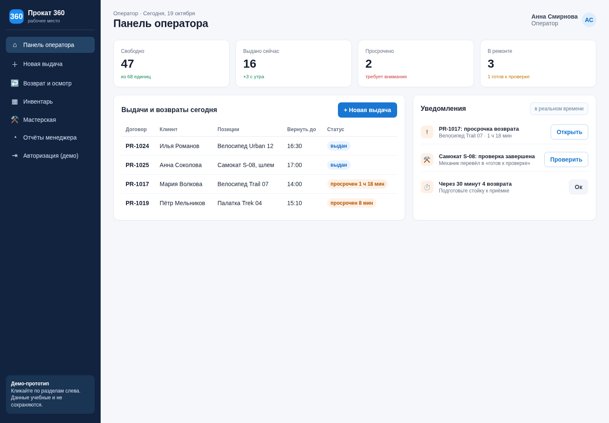
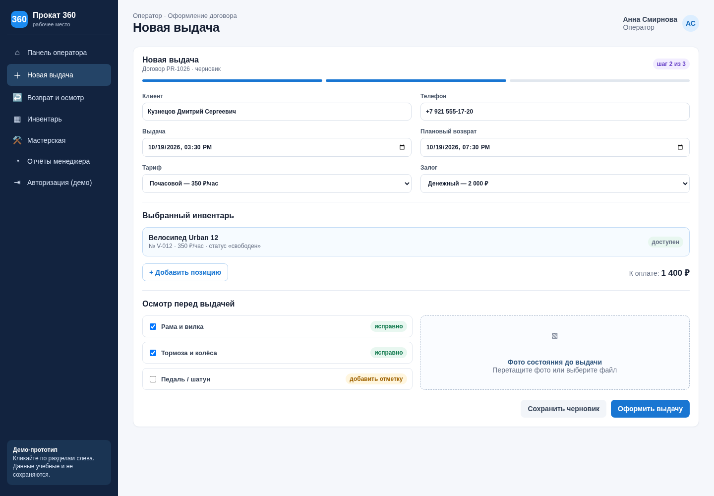
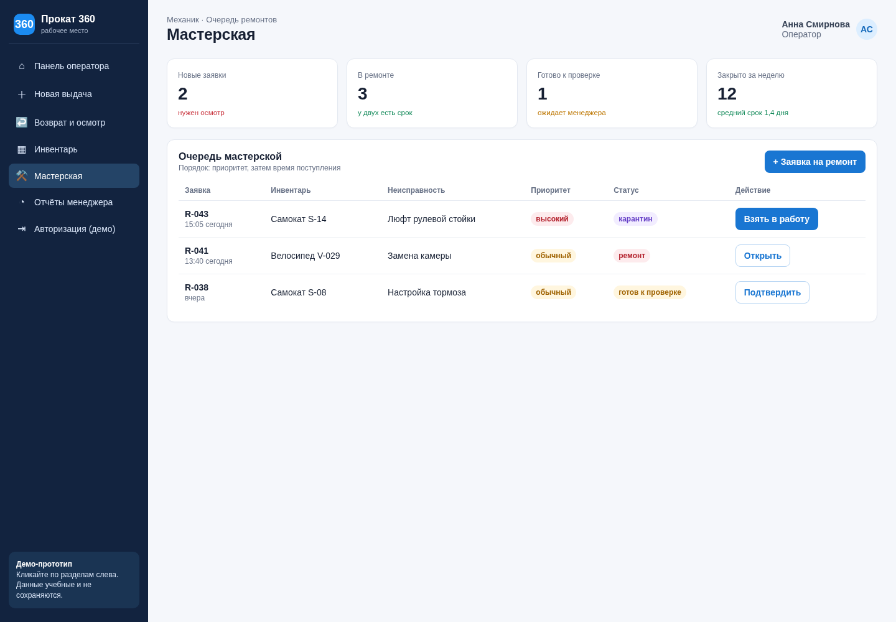

\newpage

# Паспорт проекта

| Пункт | Содержание |
|---|---|
| Заказчик | Сеть пунктов проката велосипедов, самокатов и туристического снаряжения |
| Исполнитель | ООО «Северный код» |
| Название продукта | **Прокат 360** |
| Рабочие места | Оператор пункта проката, механик, менеджер; 20–50 пользователей |
| Формат | Веб-приложение для ПК и планшетов, с адаптивным интерфейсом |
| Срок реализации | 12 рабочих недель с даты старта проекта |
| Стоимость проекта | 1 397 760 руб., включая резерв 12 % |

## 1. Идея и обоснование потребности

### 1.1. Как работа выполняется сейчас

Выдача инвентаря фиксируется в бумажном журнале. Залог в виде денег или документов хранится отдельно, а дефекты и заявки на ремонт механики оставляют на стикерах либо передают устно. Для проверки просрочек оператор вручную сверяет журнал в конце смены. Единого актуального статуса у единицы инвентаря нет.

### 1.2. Проблема

Бумажный учёт не даёт доказуемой истории состояния инвентаря, из-за чего возникают споры с клиентами. Просроченные возвраты обнаруживаются с опозданием, а неисправный предмет может ошибочно числиться свободным и быть выдан повторно. Ручная сверка отнимает время у оператора и не даёт менеджеру достоверных показателей загрузки, ремонтов и выручки.

### 1.3. Решение

**Прокат 360** — единая система, которая связывает выдачу, осмотр с фотофиксацией, залог, возврат, ремонт и отчётность в карточке каждой единицы инвентаря; она автоматически блокирует выдачу неисправного инвентаря и показывает просрочки в момент их возникновения.

### 1.4. Отличие от аналогов

Продукт сфокусирован на небольших и средних пунктах проката в России: быстрый сценарий «выдал–вернул», обязательная фотофиксация состояния, простой рабочий экран механика и статусы, понятные всем ролям. В базовую поставку входят русский интерфейс, обучение и шаблоны актов, без сложной ERP-настройки и платы за пользователя.

### 1.5. Анализ аналогов

| Критерий | Booqable | Rentman | EZRentOut | Прокат 360 |
|---|---|---|---|---|
| Основные функции | Онлайн-бронирование, инвентарь, заказы, платежи | Планирование оборудования и проектов, QR-коды, учёт ремонтов | Учёт активов, бронирование, обслуживание, мобильное приложение | Выдача/возврат, залоги, осмотр с фото, ремонт, просрочки, отчёты |
| Ценовая модель | Подписка за локацию, от базового тарифа | Подписка по модулям и пользователям | Подписка по числу активов/пользователей | Разовый проект в лимите тендера; прогнозируемая поддержка |
| Сильная сторона | Красивый клиентский каталог | Мощное планирование сложной аренды | Глубокий учёт имущества | Минимум действий на стойке и прозрачная ответственность за дефекты |
| Ограничение для заказчика | Нужна настройка под местные процессы и онлайн-оплату | Избыточен для одного пункта, выше порог обучения | Интерфейс и настройка ориентированы на универсальный asset management | Нет публичного маркетплейса и сложного планирования мероприятий в первой версии |

Источники для сравнения: официальные сайты [Booqable](https://booqable.com/), [Rentman](https://rentman.io/) и [EZRentOut](https://www.ezrentout.com/). Тарифы поставщиков меняются; для тендерного сравнения использовалась их открытая модель ценообразования, а не коммерческое предложение.

## 2. Цели проекта по SMART

| № | Цель | Показатель | Сейчас | Целевое значение | Срок |
|---:|---|---|---:|---:|---|
| 1 | Ускорить оформление выдачи | Среднее время выдачи одной позиции | 10–12 мин | не более 5 мин | через 3 месяца после запуска |
| 2 | Сделать просрочки видимыми сразу | Время обнаружения просрочки | до конца смены | не более 5 мин после планового возврата | с первого месяца |
| 3 | Устранить повторную выдачу неисправного инвентаря | Число таких выдач | не измеряется | 0 подтверждённых случаев | через 3 месяца |
| 4 | Снизить число споров о повреждениях | Споры без подтверждающей записи | 3–5 в месяц* | не более 1 в месяц | через 3 месяца |
| 5 | Обеспечить управленческий учёт | Доля единиц с актуальным статусом | нет единого учёта | 100 % на контрольной выборке | с первого месяца |

\* Базовое значение уточняется на этапе анализа по журналам за последние 3 месяца.

# 3. Техническое задание

## 3.1. Общие сведения

Наименование системы: «Прокат 360». Заказчик использует 20–50 рабочих мест и ведёт прокат велосипедов, самокатов и туристического снаряжения. Система создаётся как веб-приложение, доступное по защищённому адресу из современных браузеров. Первая версия не включает интернет-витрину, онлайн-эквайринг и интеграцию с бухгалтерией: они могут быть спланированы отдельной очередью после приёмки ядра учёта.

## 3.2. Назначение и цели

Система предназначена для оперативного учёта инвентаря и договоров проката, предотвращения выдачи предметов со статусом «ремонт» или «карантин», контроля сроков возврата и документирования состояния инвентаря. Цели: сократить ручную работу, обеспечить прослеживаемость действий и дать менеджеру достоверную картину загрузки парка.

## 3.3. Пользователи и права доступа

| Роль | Права и задачи |
|---|---|
| Оператор | Создаёт и закрывает договоры, выбирает доступный инвентарь, фиксирует залог, проводит фотоосмотр, видит текущие и просроченные выдачи. Не меняет историю ремонтов и системные тарифы. |
| Механик | Видит неисправности и назначения, создаёт/редактирует карточки ремонта, меняет статус на «карантин», «ремонт», «готов к проверке». Не видит лишние персональные данные клиентов и финансы. |
| Менеджер | Управляет каталогом, тарифами и пользователями, просматривает отчёты, назначает ответственных, утверждает корректировки залога и принимает решение по откату. |
| Администратор системы | Техническое администрирование, резервные копии, настройки интеграций и аудит. Роль выдаётся ограниченному числу сотрудников заказчика/исполнителя. |

Все действия, влияющие на договор, состояние инвентаря, залог и ремонт, пишутся в неизменяемый журнал аудита с пользователем, временем, прежним и новым значением.

## 3.4. Функциональные требования

| ID | Требование | Роль | Приоритет |
|---|---|---|---|
| FR-01 | Система должна хранить карточку каждой единицы инвентаря: уникальный номер/QR-код, тип, модель, тариф, местоположение, фотографии и текущий статус. | Менеджер | Высокий |
| FR-02 | Система должна поддерживать статусы «свободен», «забронирован», «выдан», «просрочен», «карантин», «ремонт», «готов к проверке», «списан». | Все | Высокий |
| FR-03 | При создании выдачи система должна предлагать только предметы со статусом «свободен» и блокировать сохранение при ином статусе. | Оператор | Высокий |
| FR-04 | Оператор должен создавать карточку клиента с минимально необходимыми контактными данными и отметкой о согласии на обработку персональных данных. | Оператор | Высокий |
| FR-05 | Оператор должен оформлять договор: клиент, позиции, тариф, дата и время выдачи/планового возврата, цена, залог, комментарий. | Оператор | Высокий |
| FR-06 | Перед выдачей и при возврате оператор должен фиксировать состояние каждой позиции: чек-лист, комментарий и до 5 фотографий. | Оператор | Высокий |
| FR-07 | Система должна формировать печатную форму договора и акта приёма-передачи в PDF. | Оператор | Средний |
| FR-08 | Система должна вести учёт залога: вид залога, сумма/признак, время принятия и возврата, ответственный. Номер паспорта как залог в системе не хранится. | Оператор, менеджер | Высокий |
| FR-09 | По истечении планового времени возврата система должна менять договор на «просрочен», подсвечивать его в рабочем списке не позднее чем через 5 минут и создавать уведомление оператору. | Оператор | Высокий |
| FR-10 | При возврате оператор должен выбирать: «без замечаний», «требуется осмотр» или «повреждение». При двух последних вариантах предмет переводится в «карантин». | Оператор | Высокий |
| FR-11 | Механик должен создавать заявку на ремонт с видом неисправности, описанием, фото, приоритетом, ответственным и плановой датой завершения. | Механик | Высокий |
| FR-12 | Только механик или менеджер может перевести предмет из «карантина/ремонта» в «готов к проверке», а менеджер — в «свободен» после контрольного осмотра. | Механик, менеджер | Высокий |
| FR-13 | Система должна предоставлять поиск и фильтры по номеру инвентаря, статусу, категории, договору, клиенту, сроку возврата и механику. | Все | Высокий |
| FR-14 | Менеджер должен получать отчёты по загрузке парка, просрочкам, выручке, удержанным залогам, ремонтам и простоям с экспортом в XLSX/CSV. | Менеджер | Средний |
| FR-15 | Система должна вести журнал аудита и позволять менеджеру отфильтровать действия по дате, пользователю, сущности и типу операции. | Менеджер | Высокий |
| FR-16 | Система должна поддерживать создание резервных копий БД и вложений по расписанию и журнал успешности резервного копирования. | Администратор | Высокий |

## 3.5. Нефункциональные требования

| ID | Требование | Способ проверки |
|---|---|---|
| NFR-01 | Обычная операция поиска, открытия карточки и сохранения выдачи выполняется не более чем за 2 секунды при 50 одновременных пользователях, кроме загрузки больших фото. | Нагрузочный тест с 50 виртуальными пользователями; 95-й перцентиль ≤ 2 с. |
| NFR-02 | Система доступна не менее 99,5 % в месяц, исключая согласованные окна обслуживания. | Мониторинг доступности и ежемесячный отчёт. |
| NFR-03 | Обмен данными выполняется по HTTPS; пароли хранятся в виде стойких хешей; доступ разграничен ролями. | Проверка конфигурации и тесты ролей при приёмке. |
| NFR-04 | Резервное копирование выполняется ежедневно; целевой RPO — 24 часа, RTO — не более 4 часов. | Тестовое восстановление на стенде из резервной копии. |
| NFR-05 | Интерфейс работает в последних двух версиях Chrome, Edge и Firefox; на планшете шириной от 768 px поддерживается основной сценарий выдачи. | Кроссбраузерное тестирование и демонстрация. |
| NFR-06 | Для аудита хранятся пользователь, дата/время, объект и изменённые значения. Записи аудита недоступны для редактирования обычным пользователям. | Проверка журнала и попытка неавторизованного изменения. |
| NFR-07 | Система должна соответствовать политике заказчика по персональным данным; доступ к персональным данным — только у ролей, которым он необходим. | Ревизия матрицы доступа и выборочная проверка интерфейса. |

## 3.6. Техническая среда и архитектура

Решение строится по клиент-серверной модели. Клиент — веб-интерфейс на TypeScript/React, адаптированный для ПК и планшетов. Серверная часть — API на Node.js/NestJS; данные хранятся в PostgreSQL, фотографии и PDF — в S3-совместимом объектном хранилище. Развёртывание: Linux-сервер, Docker Compose, Nginx и TLS-сертификат. Права задаются на сервере, а не только в интерфейсе.

Минимальная серверная конфигурация для первой версии: 4 vCPU, 8 GB RAM, 100 GB SSD и отдельное объектное хранилище. На рабочих местах нужен браузер, экран от 1280×720, доступ в локальную сеть/интернет и, при печати QR-меток, принтер этикеток. Для стабильной работы рекомендуется проводное подключение стойки оператора и планшет с камерой для осмотра.

```text
Оператор / Механик / Менеджер
            │ HTTPS
       Веб-приложение React
            │ API
          NestJS
       ┌────┴─────┐
 PostgreSQL   Фото и PDF (S3)
       │             │
       └── Резервные копии ──┘
```

## 3.7. Этапы разработки и критерии приёмки

Работы выполняются итеративно: после анализа согласуются прототип и перечень полей, затем разрабатывается ядро выдачи/возврата, далее — ремонт, отчёты и внедрение. Изменения, которые увеличивают согласованный объём работ, оформляются отдельным запросом на изменение и не включаются автоматически в срок и бюджет.

| Этап | Длительность | Результат | Критерий завершения |
|---|---:|---|---|
| Анализ | 2 недели | Процессы AS-IS/TO-BE, словарь статусов, уточнённое ТЗ | Заказчик согласовал прототип и ТЗ |
| Проектирование | 2 недели | Интерактивный прототип, архитектура, тестовые сценарии | Согласованы 7 экранов и модель прав |
| Разработка | 5 недель | Рабочая версия с функциями FR-01–FR-16 | Код развёрнут на тестовом стенде; нет блокирующих дефектов |
| Тестирование | 2 недели | Протокол тестирования, исправления | Пройдены критические приемочные сценарии |
| Внедрение | 1 неделя | Настроенная продуктивная система, обученные пользователи | Проведён пилот и подписан протокол запуска |

# 4. Бюджет, календарный план и TCO

## 4.1. Смета

| Статья | Состав | Количество | Стоимость, руб. |
|---|---|---:|---:|
| Разработка | Backend 270 ч × 1 500; Frontend 200 ч × 1 400; DevOps 35 ч × 1 500 | 505 ч | 737 500 |
| Проектирование и дизайн | Аналитик 75 ч × 1 300; UX/UI 75 ч × 1 000; руководитель проекта 50 ч × 1 450 | 200 ч | 245 000 |
| Тестирование | QA 85 ч × 1 000 | 85 ч | 85 000 |
| Серверы, лицензии, сервисы | Облако, резервное хранилище, домен, почтовые уведомления на 1-й год | 12 мес. | 18 000 |
| Внедрение и обучение | Развёртывание, миграция стартового справочника, 4 учебные сессии, памятки | пакет | 45 000 |
| Сопровождение (1-й год) | 25 часов консультаций, исправление дефектов, обновления безопасности | пакет | 75 000 |
| Резерв на риски | 12 % от прямых затрат | — | 144 660 |
| **ИТОГО** |  |  | **1 350 160** |

**Примечание по расчёту.** Сумма прямых затрат составляет 1 205 500 руб.; резерв 12 % — 144 660 руб. Итоговая цена проекта составляет **1 350 160 руб.** и не превышает 1 500 000 руб. Резерв расходуется только после письменного согласования заказчика.

## 4.2. Календарный план

| Этап | Начало* | Окончание* | Зависит от | Результат |
|---|---|---|---|---|
| Анализ | Неделя 1 | Неделя 2 | — | Согласованное ТЗ и карта процессов |
| Проектирование | Неделя 3 | Неделя 4 | Анализ | Прототип, схема данных, план тестов |
| Разработка | Неделя 5 | Неделя 9 | Проектирование | Тестовая версия всех обязательных модулей |
| Тестирование | Неделя 10 | Неделя 11 | Разработка | Исправленная версия и протокол |
| Внедрение | Неделя 12 | Неделя 12 | Тестирование | Пилот, обучение, запуск |

\* Даты определяются от даты заключения договора. Общая длительность — 12 рабочих недель, то есть не более 3 месяцев.

```text
Недели        01 02 03 04 05 06 07 08 09 10 11 12
Анализ        ██ ██
Проектирование      ██ ██
Разработка                ██ ██ ██ ██ ██
Тестирование                            ██ ██
Внедрение                                      ██
```

## 4.3. Совокупная стоимость владения (TCO) на 3 года

| Составляющая | 1-й год, руб. | 2-й год, руб. | 3-й год, руб. | Итого, руб. |
|---|---:|---:|---:|---:|
| Разработка, проектирование и тестирование | 1 067 500 | 0 | 0 | 1 067 500 |
| Сопровождение | 75 000 | 95 000 | 105 000 | 275 000 |
| Обучение | 45 000 | 8 000 | 8 000 | 61 000 |
| Инфраструктура | 18 000 | 24 000 | 24 000 | 66 000 |
| Бюджетный резерв | 144 660 | 0 | 0 | 144 660 |
| **ИТОГО** | **1 350 160** | **127 000** | **137 000** | **1 614 160** |

# 5. Прототип интерфейсов

## 5.1. Перечень экранов и связь с ТЗ

| Экран | Назначение | Связанные требования |
|---|---|---|
| 1. Авторизация | Вход по учётной записи, выбор рабочей роли | NFR-03, NFR-07 |
| 2. Панель оператора | Очередь выдач, просрочки, быстрый переход к новой операции | FR-02, FR-09, FR-13 |
| 3. Новая выдача | Клиент, позиции, сроки, залог, осмотр и подтверждение | FR-03–FR-08 |
| 4. Возврат и осмотр | Сверка чек-листа, фото, решение «свободен/карантин» | FR-06, FR-10 |
| 5. Инвентарь | Таблица, фильтры, статусы, поиск QR/номера | FR-01–FR-03, FR-13 |
| 6. Рабочее место механика | Очередь ремонтов, дефект, назначение и изменение статуса | FR-11, FR-12 |
| 7. Панель менеджера | Загрузка парка, выручка, просрочки, ремонты и экспорт | FR-14, FR-15 |

## 5.2. Схема навигации

```text
Авторизация
     │
     ├── Панель оператора ── Новая выдача ── Карточка договора
     │          │                     │
     │          └── Возврат и осмотр ─┴── Инвентарь
     │                                         │
     ├── Рабочее место механика ───────────────┘
     │
     └── Панель менеджера ── Отчёты / Аудит / Настройки
```

Интерактивный прототип передаётся в файле `Прототип_Прокат_360.html`. В нём предусмотрены кликабельные переходы между экранами, фильтры статусов, пример оформления выдачи и перевод дефектного предмета в карантин.

### 5.3. Ключевые экраны прототипа

{ width=94% }

{ width=94% }

{ width=94% }

# 6. Стратегия и сценарий внедрения

## 6.1. Выбранная стратегия

Выбирается **пилотное внедрение с последующим поэтапным подключением**. В течение одной недели 2–3 сотрудника (оператор, механик, менеджер) проводят реальные операции в новой системе параллельно с бумажным журналом. После устранения замечаний к системе по одному пункту подключаются остальные пользователи и в течение трёх рабочих дней поддерживается бумажный журнал как контрольная копия. Это снижает риск потери учётных данных и отторжения персоналом, но не растягивает переход на месяцы.

## 6.2. Сценарий внедрения

| Этап | Действия | Ответственный | Срок | Результат |
|---|---|---|---|---|
| Подготовка | Аудит ПК и сети, назначение ответственных, инвентаризация справочника, резервная копия текущих файлов/журналов | Менеджер заказчика, инженер исполнителя | 2 дня | Готовая среда и резервная копия |
| Установка и настройка | Развёртывание, домен/TLS, создание ролей, тарифов и категорий | DevOps, администратор | 1 день | Доступна тестовая продуктивная среда |
| Миграция данных | Загрузка перечня инвентаря, актуальных выдач, клиентов; очистка дублей; выборочная сверка | Аналитик, менеджер | 1 день | Подписанный акт сверки данных |
| Пилот | Реальные операции 2–3 пользователей, сбор замечаний, ежедневная проверка статусов | Ключевые пользователи, PM | 5 дней | Реестр замечаний и решение о запуске |
| Обучение | Ролевые занятия, практика на тестовых кейсах, выдача памяток | Тренер исполнителя | 2 дня | Обученные пользователи, листы присутствия |
| Полный запуск | Подключение всех пользователей, контроль первой смены, канал поддержки | Менеджер, PM | 1 день | Система принята в эксплуатацию |
| Сопровождение | Мониторинг, бэкапы, консультации, исправление дефектов | Служба поддержки | 12 месяцев | SLA-отчёты и обновления |

## 6.3. План обучения

| Группа | Формат | Длительность | Материалы |
|---|---|---:|---|
| Операторы (до 20 чел.) | Две практические группы по 10 человек | 2 ч на группу | Памятка «Выдача, возврат, просрочка», тестовый стенд |
| Механики (до 10 чел.) | Очный/дистанционный практикум | 1,5 ч | Памятка «Карантин и ремонт», карточки дефектов |
| Менеджеры и администраторы (до 5 чел.) | Демонстрация и работа с отчётами | 1,5 ч | Руководство администратора, сценарий приёмки |
| Новые сотрудники | Запись занятия + наставник | 45 мин | Видео, краткая инструкция, тестовый аккаунт |

## 6.4. Критерии приёмки

| № | Критерий | Способ проверки |
|---:|---|---|
| 1 | В систему загружены 100 % единиц инвентаря из согласованного стартового реестра; для каждой указан статус. | Сверка количества, 10 % выборка карточек. |
| 2 | В тесте на выдачу система не позволяет выбрать предмет со статусом «ремонт», «карантин», «выдан» или «просрочен». | Демонстрация 4 негативных сценариев. |
| 3 | При возврате с повреждением система создаёт фотоосмотр и переводит предмет в «карантин»; он исчезает из списка доступных. | Сквозной сценарий на тестовой единице. |
| 4 | Просроченный договор появляется в панели оператора не позднее 5 минут после планового срока. | Тест с сокращённым сроком возврата и замером времени. |
| 5 | Восстановление тестовой резервной копии завершается менее чем за 4 часа, данные доступны и сверены. | Протокол тестового восстановления. |

## 6.5. Метрики успеха

| Метрика | Сейчас | Через 1 месяц | Через 3 месяца | Способ замера |
|---|---:|---:|---:|---|
| Время типовой выдачи | 10–12 мин | ≤ 7 мин | ≤ 5 мин | Выборка 20 операций по журналу/аудиту |
| Повторная выдача неисправного предмета | нет данных | 0 | 0 | Реестр инцидентов |
| Споры без подтверждённого осмотра | 3–5/мес.* | ≤ 2/мес. | ≤ 1/мес. | Журнал претензий |
| Удовлетворённость персонала (1–5) | не измеряется | ≥ 3,8 | ≥ 4,2 | Анонимный опрос |
| Обращения в поддержку | не измеряется | ≤ 20/мес. | ≤ 8/мес. | Тикет-система |

# 7. Риски и план отката

## 7.1. Реестр рисков

| Риск | Вероятность (1–5) | Влияние (1–5) | Оценка | Меры снижения |
|---|---:|---:|---:|---|
| Неполный или недостоверный исходный список инвентаря | 3 | 4 | 12 | Прединвентаризация, импорт в тестовый контур, акт сверки, маркировка QR-кодами. |
| Сотрудники пропускают фотоосмотр | 3 | 4 | 12 | Обязательный чек-лист при выдаче/возврате, обучение, контроль менеджером первых смен. |
| Сопротивление персонала новому процессу | 3 | 3 | 9 | Пилот с ключевыми пользователями, короткие сценарии, памятки и канал быстрых вопросов. |
| Недоступность сети или сервера в рабочее время | 2 | 5 | 10 | Мониторинг, резервные копии, регламент аварийной бумажной формы и последующий ввод. |
| Утечка персональных данных/данных о залоге | 2 | 5 | 10 | Роли, HTTPS, минимизация данных, аудит входов, резервное копирование с ограниченным доступом. |
| Ошибка миграции актуальных договоров | 2 | 4 | 8 | Тестовая миграция, выборочная сверка, сохранение исходного файла и бумажного журнала. |
| Рост объёма работ из-за новых пожеланий | 3 | 3 | 9 | Заморозка объёма первой версии, реестр изменений, оценка каждого запроса до реализации. |
| Неправильное изменение статуса после ремонта | 2 | 4 | 8 | Маршрут «карантин → ремонт → готов к проверке → свободен», права по ролям и журнал аудита. |

## 7.2. План отката

Откат запускается, если выполняется хотя бы одно условие: обнаружено несоответствие критичных данных более чем у 1 % активных договоров; в течение первой смены не работают выдача или возврат более 30 минут; критический дефект не устранён за 4 часа; либо руководитель заказчика фиксирует риск потери данных. Решение принимает менеджер заказчика совместно с руководителем проекта исполнителя.

1. Менеджер останавливает новые операции в системе и уведомляет персонал в чате/по телефону.
2. Операторы временно используют заранее подготовленную бумажную форму выдачи и возврата; время начала режима фиксируется.
3. Исполнитель сохраняет журналы приложения, делает снимок БД и восстанавливает последнюю проверенную резервную копию на отдельный контур.
4. Менеджер сверяет активные договоры, залоги и статусы инвентаря с контрольным листом и бумажными записями с момента сбоя.
5. После устранения причины выполняется повторный пилот на 2–3 пользователях. Решение о возвращении в продуктивный режим оформляется коротким актом.

# 8. Вывод

«Прокат 360» устраняет ключевые причины конфликтов и потерь в пункте проката: каждая выдача и возврат получают подтверждённую историю состояния, а неисправный инвентарь технически невозможно выдать повторно. Оператор видит просрочки сразу, механик работает с прозрачной очередью ремонтов, а менеджер получает целостную картину по парку. Первая версия укладывается в 12 рабочих недель и бюджет 1 350 160 руб. Внедрение начинается с контролируемого пилота, поэтому персонал осваивает систему без остановки работы пункта. Риски миграции, доступности и сопротивления сотрудников учтены в плане снижения и отката. После стабилизации первой версии логичным развитием станут онлайн-бронирование, эквайринг и интеграция с бухгалтерией.

# Приложение А. Содержание презентации

1. Компания и продукт «Прокат 360».  
2. Проблема и цена ручного учёта.  
3. Решение и отличия от аналогов.  
4. Ключевые функции.  
5. Интерфейсы оператора и механика.  
6. Архитектура и защита данных.  
7. Смета и срок.  
8. Сценарий внедрения и обучение.  
9. Риски и план отката.  
10. Ожидаемый эффект и предложение заказчику.
